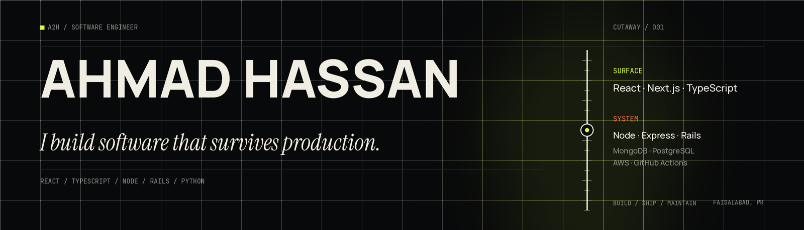
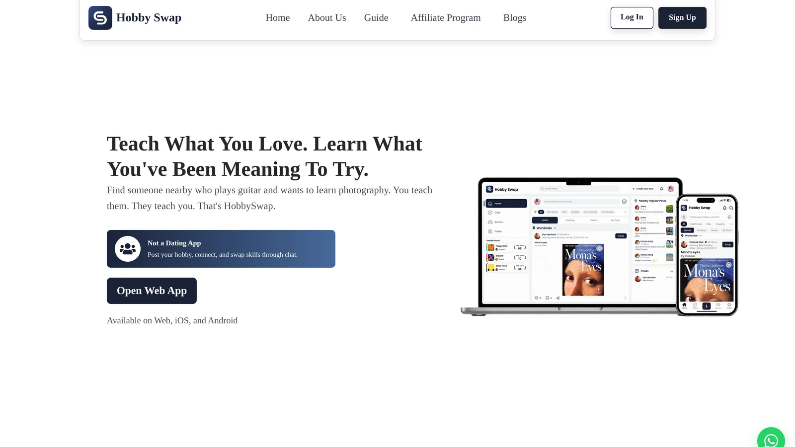
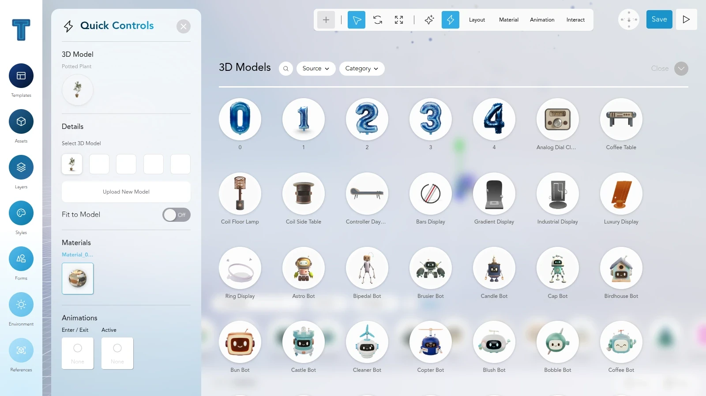
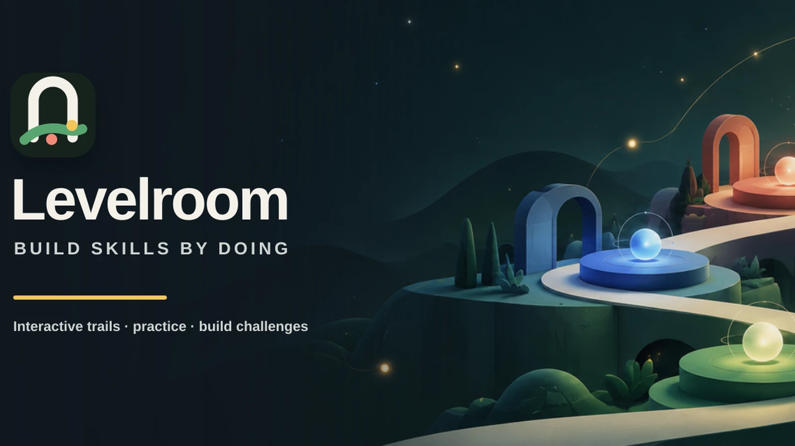
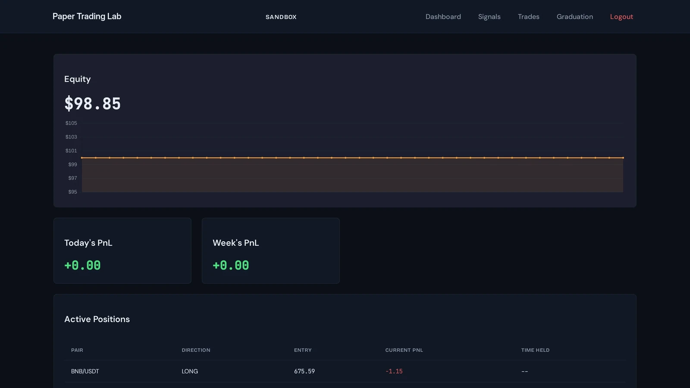

  <picture>
    <source media="(prefers-color-scheme: dark)" srcset="./assets/hero-dark.png">
    <source media="(prefers-color-scheme: light)" srcset="./assets/hero-light.png">
    
  </picture>

I'm a software engineer at **DevHouse** in Faisalabad. Most of my work has been on web products: **HobbySwap**'s API, Next.js client, admin dashboard, and 15-locale marketing site. Lately I've been working on **Trace**'s React/TypeScript frontend, tests, and build tooling.

[LinkedIn](https://www.linkedin.com/in/a2hassan) · [HobbySwap](https://hobbyswap.net/) · [Trace](https://www.trace3d.app/)

##  Selected work

### HobbySwap
<code>PRIMARY DEV</code> <code>2024–25</code>  
A skills-swapping social platform. **90** routes · **15** locales.  
[Live site ↗](https://hobbyswap.net/)

### Trace
<code>FRONTEND</code> <code>2025–now</code>  
A 3D/AR scene editor. **4,436** tests · **123s → 18s** warm build.  
[Live product ↗](https://www.trace3d.app/)

### Levelroom
<code>PERSONAL</code> <code>2026</code>  
Local-first learning trails with an **AI tutor** and **spaced review**.  
[Repository ↗](https://github.com/hassan-a2h/level-room)

### Paper Trading Lab
<code>PERSONAL</code> <code>2026</code>  
Paper-only trading research. **No real money**; runs locally.

##  Stack

**Client**  
    

**Server**  
     

**Data**  
 

**Ship & test**  
  

##  Experience

> **DevHouse** · Software Engineer · 2024–  
> HobbySwap → Trace
>
> **EpochClan** · Full Stack JavaScript Developer Intern · 2024  
> React reporting · AWS Lambda
>
> **Upwork & Fiverr** · Freelance Software Engineer · 2023–24  
> React · Python automation
>
> **DevsInc** · Associate Software Engineer · 2022–23  
> Rails · Devise · Pundit

<strong>FAST-NUCES</strong> · BS Computer Science · 2018–22

##  Contact

The best way to reach me is LinkedIn.

